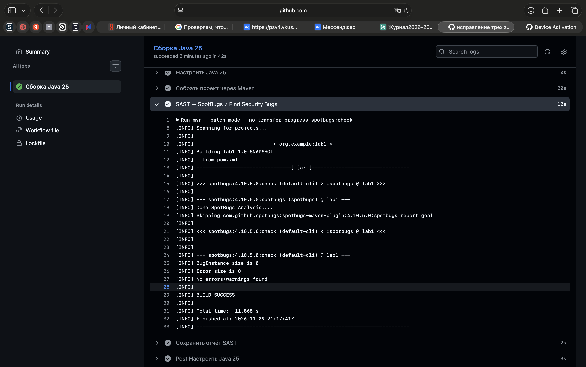
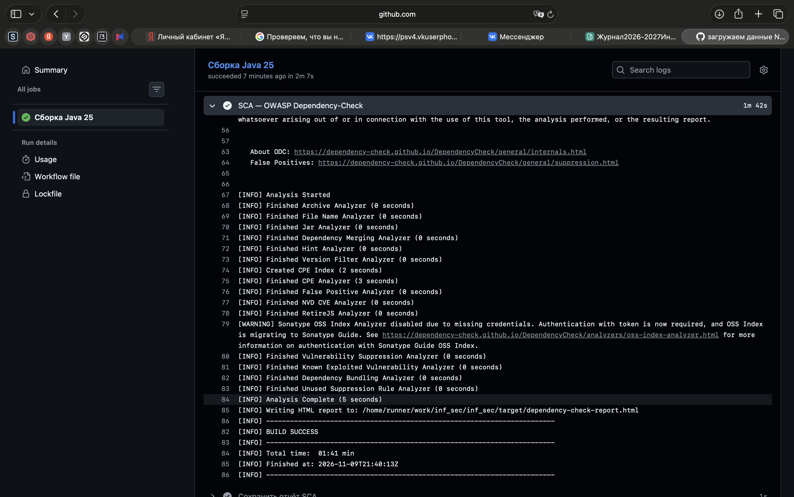
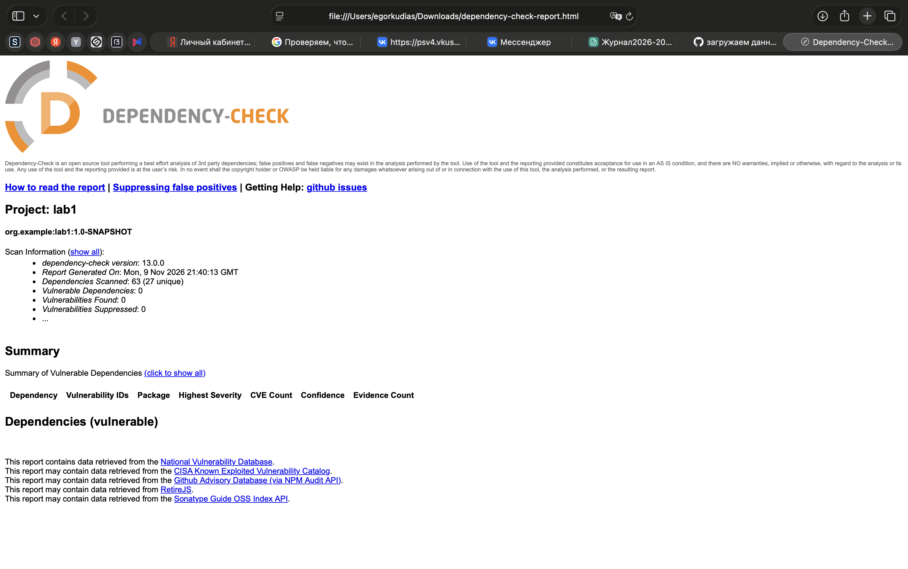

# Лабораторная работа № 1. Защищённый REST API с проверками безопасности в CI

Приложение позволяет пользователю войти по логину и паролю, создать личную заметку и получить список своих заметок. Заметки сохраняются в PostgreSQL. Доступ к ним требует JWT.

Стек проекта — Java 25, Spring Boot 4.1.2, Spring Security, Spring JDBC, PostgreSQL 16 и Maven. Сборку и проверки безопасности выполняет GitHub Actions.

## Запуск в IntelliJ IDEA

Открой проект как Maven-проект и выбери JDK 25. Команды ниже выполняются из корня проекта, где находится `pom.xml`. Для запуска нужны работающий PostgreSQL и утилита `htpasswd`. Для примеров запросов используются `curl` и Python 3.

### База данных

При первой настройке создай пользователя приложения и базу. Выполняй команды под локальной учётной записью PostgreSQL с правами на создание ролей и баз.

```bash
createuser -h 127.0.0.1 --pwprompt lab1_app
createdb -h 127.0.0.1 --owner=lab1_app lab1_notes
```

Приложение подключается к `jdbc:postgresql://127.0.0.1:5432/lab1_notes`. При запуске скрипт `src/main/resources/schema.sql` создаёт таблицу `notes` с полями `id`, `owner_name` и `body`. Существующие заметки сохраняются после перезапуска.

### Учебные пользователи

Создай в корне проекта файл учётных записей и задай пароли для Алисы и Боба:

```bash
touch .lab-users
chmod 600 .lab-users
htpasswd -B -C 12 .lab-users alice
htpasswd -B -C 12 .lab-users bob
```

Файл `.lab-users` содержит логины и bcrypt-хеши.

### Запуск приложения

В IntelliJ IDEA открой **Run → Edit Configurations → Lab1Application**. В **Environment variables** добавь `LAB_DB_PASSWORD` со значением пароля пользователя PostgreSQL `lab1_app`. Рабочей директорией укажи корень проекта, чтобы приложение нашло `.lab-users`.

Запусти `org.example.lab1.Lab1Application`. После сообщения `Started Lab1Application` API доступен по адресу `http://127.0.0.1:8080`.

## Методы API

| Метод | Назначение | Результат |
|---|---|---|
| `POST /auth/login` | Вход по JSON с полями `username` и `password` | `200` и JWT, при неверном пароле — `401` |
| `POST /api/data` | Создание личной заметки по JSON с полем `text` | `201`, при пустом тексте или длине более 500 символов — `400` |
| `GET /api/data` | Чтение заметок владельца JWT | `200` и список заметок, без токена — `401` |

Оба метода `/api/data` используют заголовок `Authorization: Bearer <JWT>`.

### Пример проверки через curl

Выполни команды в одной вкладке терминала. Функция `lab_token` запрашивает пароль скрытым вводом, отправляет JSON на `/auth/login` и извлекает `access_token` из ответа.

```bash
API=http://127.0.0.1:8080

lab_token() {
  python3 -c 'import getpass, json, sys
print(json.dumps({"username": sys.argv[1], "password": getpass.getpass("Пароль: ")}))' "$1" |
    curl -fsS "$API/auth/login" -H 'Content-Type: application/json' --data-binary @- |
    python3 -c 'import json, sys; print(json.load(sys.stdin)["access_token"])'
}

ALICE_TOKEN=$(lab_token alice)
```

Создание и чтение заметки от имени Алисы:

```bash
curl -i "$API/api/data" \
  -H "Authorization: Bearer $ALICE_TOKEN" \
  -H 'Content-Type: application/json' \
  -d '{"text":"Первая заметка Алисы"}'

curl -i "$API/api/data" -H "Authorization: Bearer $ALICE_TOKEN"
```

Проверка доступа без токена и от имени другого пользователя:

```bash
curl -i "$API/api/data"

BOB_TOKEN=$(lab_token bob)
curl -i "$API/api/data" -H "Authorization: Bearer $BOB_TOKEN"
```

При проверке Алиса получила `201` при создании и `200` со своей заметкой при чтении. Запрос без токена вернул `401`. Боб получил `200` и `[]`, поскольку своих заметок у него ещё не было.

## Реализованные меры защиты

**SQL-инъекции.** `NotesController` использует параметризованные запросы `JdbcTemplate`. При записи SQL содержит `VALUES (?, ?)`, а при чтении — `WHERE owner_name = ?`. Значения передаются через параметры `PreparedStatement`. В ходе проверки PostgreSQL сохранил фрагмент `' || 'SQL` буквально как часть заметки.

**XSS.** Текст хранится в исходном виде. Перед включением заметки в JSON контроллер применяет `HtmlUtils.htmlEscape(...)`. При проверке в базе сохранилось `<script>alert(1)</script>`, а API вернул `&lt;script&gt;alert(1)&lt;/script&gt;`.

**Пароли.** При создании учётной записи `htpasswd` генерирует соль и вычисляет bcrypt-хеш с параметром стоимости 12. При входе `AuthController` проверяет пароль через `BCryptPasswordEncoder.matches(...)`. Запрос с неверным паролем вернул `401`.

**JWT и контроль доступа.** После успешного входа сервер выдаёт JWT с подписью HS256 на 15 минут. Цепочка фильтров Spring Security требует аутентификацию для `/api/**` и проверяет подпись, издателя и срок действия токена. Контроллер берёт владельца заметки из проверенного поля `sub`. В эксперименте исходный токен Алисы дал `200`, а замена `sub` на `bob` с сохранением старой подписи привела к `401`. Ключ подписи генерируется при запуске, поэтому после перезапуска приложения требуется повторный вход.

## Проверки безопасности в GitHub Actions

Workflow `.github/workflows/ci.yml` запускается при `push`, а также при открытии и обновлении pull request. Он собирает проект на Java 25 командой `mvn verify`, выполняет SAST и SCA и сохраняет отчёты в разделе **Artifacts**.

### SAST — SpotBugs и Find Security Bugs

Первый анализ выявил три замечания. В ходе исправлений класс `AuthController` объявлен `final`, `NotesController` создаёт свой `JdbcTemplate` из `DataSource`, а в `SecurityConfig` глобальное отключение CSRF заменено точечным исключением для `POST /auth/login`. После исправлений SpotBugs сообщил о нуле находок и нуле ошибок анализа.



### SCA — OWASP Dependency-Check

Сканер проверяет Maven-зависимости по данным об известных уязвимостях. Данные NVD загружаются из официальных JSON-файлов. Для остановки сборки установлен порог CVSS 9.0. HTML-отчёт сохраняется в артефакте `sca-dependency-check`.

В зафиксированном отчёте Dependency-Check 13.0.0 проверил **63 зависимости, из них 27 уникальных**. Уязвимых зависимостей — **0**, найденных уязвимостей — **0**, подавленных — **0**.




